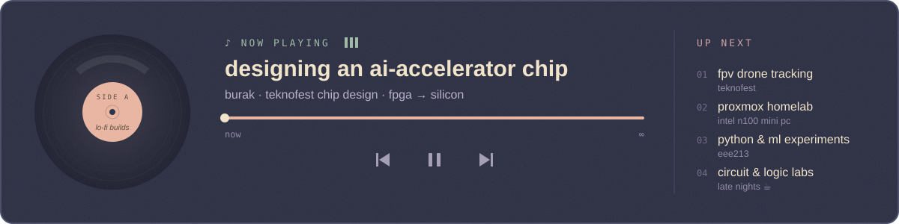

  

  hi, i'm burak 🌙 — an electrical &amp; electronics engineering student at i̇kçü, i̇zmir. 
  i tinker with circuits, digital logic and fpgas, chase drones every now and then, 
  and keep a tiny homelab humming quietly in the corner.

 

  

<h3 align="center">🧰 things on my desk</h3>

  
  
  
  
  
  

 

  

